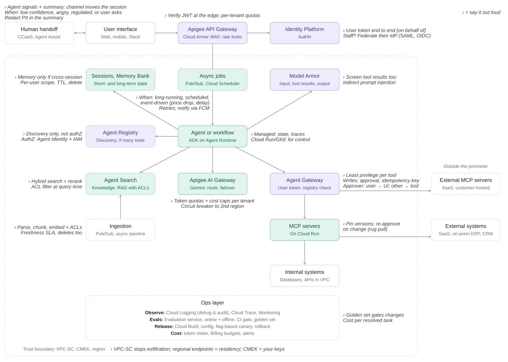
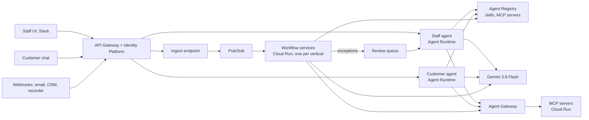

# Fleet on GCP — new architecture

- **Decision:** rebuild Fleet in a **new, GCP-native repo**.
  - It uses GCP services directly: no provider-neutral interfaces, no fakes, no switching to other clouds.
  - This repo stays as the local reference. Its domain assets get ported; its code doesn't.
- **Budget:** about $50 a month for learning. Not a new customer, so there's no $300 credit.
- **Prices checked:** 2026-10-03.

## Principles

- **Agents for judgment, workflows for procedure.** Both use the same ADK and the same skills.
- **Split deployments by who they act as, not by feature.**
- **Each capability is a skill:** an SOP in `SKILL.md`, loaded on demand.
- **Use a subagent only to keep context isolated.**

## Reference diagram

The template's single "Agent or workflow" box becomes the three roles below. Other changes for the trial are listed under [Changes from the template](#changes-from-the-template-for-the-trial).

## Three roles

| Role | Trigger | Acts as | Host |
|---|---|---|---|
| Staff agent | Chat (UI, Slack) | The user, by delegation: effective access = agent ∩ user | Agent Runtime |
| Customer agent | Public chat | The end customer; read-only tools | Agent Runtime |
| Workflows | Pub/Sub, webhooks | **Itself**, as a service identity | Cloud Run, one service per vertical |

- **Staff agent:** one agent for every staff-facing capability. It searches and loads only the skills the tenant has enabled.
- **Customer agent:** a separate deployment, with its own identity.
  - It never sits on the same agent as `post_to_ledger`.
  - Refunds become drafts in the review queue.
- **Workflows:**
  - Built with ADK workflow agents (Sequential, Parallel, Loop) or the graph Workflow API: fixed control flow, with LLM calls inside the steps.
  - The LLM steps load the same skills as the agents.
  - Ingress: webhook → API Gateway → ingest endpoint (checks the signature, publishes) → Pub/Sub → workflow. Pub/Sub gives buffering, retries and a dead-letter queue.
  - Approvals: checkpoint and resume; don't hold the request open. Pub/Sub's ack deadline maxes out at 600 s.
  - Exceptions go to the review queue, which staff work through the staff agent.
  - **One Cloud Run service per vertical, all from the same image.**
    - A workflow has no user, so its service identity is its entire permission set.
    - Separate services keep `post_to_ledger`, `crm_write` and `send_email` from sharing one identity.
    - Idle services scale to zero, so the split costs nothing.

## Where each vertical lands

| Vertical | Customer agent | Workflow trigger | Staff agent skills |
|---|---|---|---|
| Triage | Live chat answers, order status | Inbound ticket (email, web form) | Review queue, approve refunds |
| Payable | — | Invoice arrives (email, upload, GCS) | Exceptions, "why was this flagged?", approve posting |
| Prospect | — | CSV upload, CRM webhook | Review drafts, approve sends |
| Follow-Through | — | Recorder webhook, transcript upload | Fix owners, approve external emails |
| Redline | — | — | Contract review (interactive upload) |

- **Subagents**, each returning a summary:
  - Prospect: web research across many untrusted pages.
  - Redline: long contracts.
  - Follow-Through: long transcripts.

## Skills and tools

- **Expect 20+ skills:** several SOPs per vertical. So use skill search from day one.
- **Where skills live:** Agent Registry's Skill resource, a ZIP with a root `SKILL.md`. The Skill registry is in public preview.
- **How the agent loads them:** ADK `SkillToolset` with `GCPSkillRegistry`, which adds the `search_skills` and `load_skill` tools.
  - Python only, ADK ≥ 1.27, Preview.
- **Two-level index:**
  - The prompt lists the tenant's enabled verticals.
  - `search_skills` finds the SOP within a vertical.
- **Scope search to the tenant's enabled skills.**
  - Verify whether registry search can filter by tenant.
  - If it can't, wrap it in a tool that filters results by entitlement.
- **Tools:** MCP servers on Cloud Run, one per vertical, registered in Agent Registry.
  - A skill only *names* its tools (`adk_additional_tools`).
- **Enforcement:** Agent Gateway decides what may run.
  - Per-agent IAM policies, with CEL conditions on the tool name and on annotations (read-only, destructive, idempotent).
  - Gateway policies key on the **agent's** identity, not the tenant's. The MCP servers must also check the tenant's entitlement.
- **Adding a vertical** = skills + MCP server + registry entries + golden set + gateway policy.

## Changes from the template for the trial

| Template box | Trial choice | Why |
|---|---|---|
| Apigee API Gateway | **API Gateway** (2M calls/month free) | Apigee charges an environment fee every hour, even idle: $365–1,460/month |
| Apigee AI Gateway | Call Gemini directly; retries, regional failover and per-tenant token caps in code | The AI policies need Apigee Intermediate ($1,460/month) |
| Cloud Armor | Skip | ~$28/month, mostly the load balancer it needs |
| Trust boundary | Pin the region; defer VPC-SC and CMEK | Agent Gateway's IAM policies are Preview and don't support VPC-SC yet |
| Human handoff (CCaaS) | Review queue in the staff agent | No contact centre needed for the trial |
| Agent Search | Keep, for the Triage KB | 10K queries/month free |
| Everything else | As in the template | |

## What to copy from this repo

| From | Becomes |
|---|---|
| `support-agent/data/golden/*.jsonl` | Eval sets. Re-label first: the labels were generated by a model or a fake (open question Q3). |
| `support-agent/data/kb/` (`ubuntu_docs.jsonl`, `MANIFEST.json`, `ATTRIBUTION.md`) | Agent Search data store import |
| `support-agent/data/fixtures/orders.json` | Seed data for the order MCP server |
| `support-agent/data/generated/tickets.jsonl` | Synthetic tickets for workflow tests |
| `support-agent/src/triage/escalation.py`; prompts in `classifier.py` and `resolver.py` | Triage skills (`SKILL.md`) |
| `support-agent/src/triage/tools/`, `config.py` (risk tiers) | Logic and input validation for the Triage MCP server |
| `invoice-agent/`, `lead-research-agent/`, `meeting-action-agent/`, `contract-review-agent/` `plan.md` | Source SOPs for each vertical's skills, plus its eval metrics |
| `landing-page/` | As is; point `trial.js` at the customer agent |
| `overview.md` | Product positioning |

- **Leave behind:**
  - `shared-infra/`: the spine's interfaces, fakes and lazy adapters, plus the placeholder Terraform.
  - The pipeline and API code.
  - `support-agent/baselines/`: scored by a fake judge. Regenerate them on the real model.

## Build order

1. **Set up:**
   - Set a $50 budget with alerts at 50%, 90% and 100%. Alerts don't cap spend.
   - Scaffold with `agents-cli`: an ADK project with Agent Runtime and Cloud Run targets, plus CI/CD.
2. **Triage end to end:**
   - KB in Agent Search, the Triage MCP server and skills in the registry.
   - The customer agent and the ticket workflow.
   - The eval gate in CI.
3. **Staff agent:** with the review queue.
4. **The other verticals,** one at a time, each with the five parts listed under Skills and tools.

## Trial cost

Assumptions:

- 500 chat sessions a month × 6 model calls, plus 300 workflow runs × 4 calls.
- Each call is 4K tokens in and 500 out, on Gemini 3.8 Flash.
- 300 invoice pages through Document AI and 2K Agent Search queries.
- Model Armor on every model input and output.

| Line | Per month |
|---|---|
| Gemini 3.8 Flash ($0.75 / $3.75 per 1M tokens until 31 Dec 2026, then $1.50 / $7.50) | $20 until 31 Dec; $41 after |
| Agent Runtime ×2, Agent Gateway, Agent Registry, Sessions + Memory Bank | ≤ $9 (shared free pool: 50 vCPU-h, 100 GiB-h) |
| Model Armor ($0.10 per 1M tokens, 2M/month free) | ~$2 |
| Cloud Run ×4, Pub/Sub, Firestore, Logging, Trace, Secret Manager, GCS | ≤ $3 (always-free tiers) |
| Agent Search ($1.50 per 1K queries; 10K/month free) | ≤ $3 |
| Document AI (Invoice parser $0.10 per document) | $3–10 |
| Identity Platform, API Gateway | $0 |
| **Total** | **~$25–50 until 31 Dec; ~$45–70 after** |

- **Not included:**
  - Apigee: $365–1,460/month.
  - Cloud Armor + load balancer: ~$28/month.
  - RAG Engine in Spanner mode: ~$90/month (unverified).
- **Staying under $50 from January:**
  - Use Gemini 3.1 Flash-Lite ($0.25 / $1.50) for the classify, route and extract steps.
  - Real learning usage will likely be well below the assumed volume.
  - Use context caching for the system prompt and the skill index.
  - Per-tenant daily token caps in code.
  - Thinking tokens can roughly double output cost, so cap the thinking budget.
- **Agent Runtime settings:**
  - Set `min_instances` to 0. The default is 1, and idle instances are unbilled only "subject to change".
  - Set `resource_limits` to 1 vCPU. The default is 4.

## Sources

- [Agent Platform pricing](https://cloud.google.com/products/gemini-enterprise-agent-platform/pricing) · [Agent Platform release notes](https://docs.cloud.google.com/gemini-enterprise-agent-platform/release-notes) · [Deploy an agent](https://docs.cloud.google.com/gemini-enterprise-agent-platform/scale/runtime/deploy-an-agent)
- [Agent Registry overview](https://docs.cloud.google.com/agent-registry/overview) · [Register skills](https://docs.cloud.google.com/agent-registry/register-skills) · [Agent Registry pricing](https://docs.cloud.google.com/agent-registry/pricing)
- [ADK skills](https://adk.dev/skills/) · [ADK skills registry](https://adk.dev/integrations/skills-registry/) · [ADK Agent Registry client](https://adk.dev/integrations/agent-registry/)
- [Agent Gateway](https://docs.cloud.google.com/gemini-enterprise-agent-platform/govern/gateways/agent-gateway-overview) · [Gateway IAM policies](https://docs.cloud.google.com/gemini-enterprise-agent-platform/govern/policies/configure-iam-policies)
- [Choose an agentic design pattern](https://docs.cloud.google.com/architecture/choose-design-pattern-agentic-ai-system)
- [Gemini pricing](https://cloud.google.com/gemini-enterprise-agent-platform/generative-ai/pricing) · [Model Armor pricing](https://cloud.google.com/security-command-center/pricing) · [Agent Search pricing](https://cloud.google.com/generative-ai-app-builder/pricing) · [Document AI pricing](https://cloud.google.com/products/document-ai/pricing)
- [Apigee pricing](https://cloud.google.com/apigee/pricing) · [API Gateway pricing](https://cloud.google.com/api-gateway/pricing) · [Cloud Armor pricing](https://cloud.google.com/armor/pricing) · [Cloud Run pricing](https://cloud.google.com/run/pricing)
